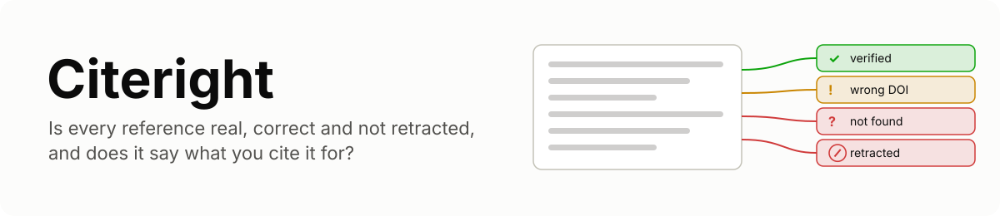

<picture>
  <source media="(prefers-color-scheme: dark)" srcset="docs/assets/banner-dark.svg">
  
</picture>

**Citeright checks every citation in a draft: that the reference exists, that it is the
paper you meant, that it has not been retracted, and that the cited work actually says
what the sentence citing it claims.**

Writing assistants produce references that look right and are not: a plausible title, real
author names, a DOI with a real publisher's prefix. People make the quieter mistakes:
a wrong year, a DOI copied from the neighbouring entry, a paper cited for a result it
does not contain, a study cited years after its retraction. Link checkers catch only a
DOI that does not resolve. Asking an LLM "is this reference real?" asks the same kind of
model that invented it.

Citeright looks each reference up in the scholarly record and checks each citing
sentence against the cited text:

1. **Is it real?** DOIs are checked against the DOI handle system, then the reference
   is matched to records in Crossref, OpenAlex and arXiv by title, authors, year and
   venue. A model fitted on real references with planted faults turns the comparison
   into a calibrated match probability; nothing is a hand-set threshold.
2. **Is it right?** When the work exists but a field is wrong, Citeright says which
   field and what the record says: "DOI 10.1038/nature14539 belongs to another work
   ('Deep learning'); this work's DOI is 10.1109/cvpr.2016.90".
3. **Is it retracted?** Retractions, corrections and expressions of concern come from
   Crossref's Retraction Watch data and OpenAlex, with the notice's date and DOI.
4. **Does it say that?** Each citing sentence is checked against the passages of the
   cited abstract (or full text, if you have it) that match it best, with a calibrated
   verdict: supports, contradicts, or not found in the cited work, and the passage
   that decides it.

<!-- demo animation -->

## Quickstart

```bash
pip install "citeright[models] @ git+https://github.com/Sanika0212/Citeright"
citeright check paper.tex --bib refs.bib --html report.html
```

It reads LaTeX (`\cite`, `\citep`, `\citet`, ...), Pandoc Markdown (`[@key]`),
numbered (`[1]`, `[2-4]`) and author-year citations, with a BibTeX file, a
`thebibliography` block or a plain reference list.

On [examples/draft.md](examples/draft.md), a short text with real papers and five
planted problems:

<!-- demo output -->

The HTML report is a single file with no external requests: a summary, a graph of
which sentences cite which references, every reference with what is wrong with it, and
every citing sentence with the passage that decides it.

<!-- report screenshot -->

## In CI

```bash
citeright check paper.tex --bib refs.bib --no-support --fail-on retracted,not_found
```

exits with 1 when the draft cites a retracted work or a reference that cannot be found,
so a paper repository can refuse to merge one. `--json findings.json` writes everything
for other tools.

## In Python

```python
from citeright.check import check
from citeright.report import write_report

report = check(open("paper.tex").read(), open("refs.bib").read())
for r in report.resolutions:
    print(r.reference.key, r.status.value, r.issues)
for c in report.checks:
    print(c.verdict.value, round(c.probability, 2), c.citation.claim, c.evidence)
write_report(report, "report.html")
```

Every HTTP response is cached in `~/.cache/citeright`, so checking the draft again
after an edit makes no new requests for unchanged references. OpenAlex limits anonymous
searches per day; Citeright searches Crossref first and uses OpenAlex as a fallback.
Set `OPENALEX_API_KEY` for a larger budget, and `CITERIGHT_MAILTO` if you want your
address sent to the APIs' polite pools (it is never sent otherwise).

## Results

<!-- results -->

## How it works

[docs/how-it-works.md](docs/how-it-works.md) covers parsing, resolution and the match
model, retraction data, and the support check with its calibration.
[docs/benchmarks.md](docs/benchmarks.md) describes both benchmarks and how to reproduce
them.

## Limits

1. **An abstract is not the paper.** Without full text, "not found" means "not in the
   abstract". The report always says which text was checked; pass full texts with
   `--texts` for a stronger check.
2. **Metadata has gaps.** Books, theses, very recent preprints and works without a DOI
   are harder to resolve. Treat a `not_found` for those as a lead to check by hand.
3. **The support check reads English** and is calibrated on biomedical and general
   scientific writing. `citeright bench support` refits it on labelled pairs from
   your field.
4. **Retraction data is as complete as Crossref's and OpenAlex's.**

## Development

```bash
uv sync --extra models --extra bench --extra viz
uv run ruff check src tests scripts && uv run mypy
uv run coverage run -m pytest && uv run coverage report
```

Tests never touch the network or download weights. See
[CONTRIBUTING.md](CONTRIBUTING.md).

## References

1. Wadden et al., *Fact or Fiction: Verifying Scientific Claims*, EMNLP 2020 (SciFact).
2. Sarol, Ming, Kilicoglu et al., *Assessing Citation Integrity in Biomedical
   Publications: Corpus Annotation and NLP Models*, Bioinformatics 2024.
3. Walters and Wilder, *Fabrication and errors in the bibliographic citations generated
   by ChatGPT*, Scientific Reports 2023.
4. Priem, Piwowar and Orr, *OpenAlex: A fully-open index of scholarly works, authors,
   venues, institutions, and concepts*, 2022.
5. Laurer, van Atteveldt, Casas and Welbers, *Less Annotating, More Classifying:
   Addressing the Data Scarcity Issue of Supervised Machine Learning with Deep Transfer
   Learning and BERT-NLI*, Political Analysis 2024.
6. Tang, Laban and Durrett, *MiniCheck: Efficient Fact-Checking of LLMs on Grounding
   Documents*, EMNLP 2024.

## License

Apache License 2.0. Copyright 2026 Sanika Najan. See [LICENSE](LICENSE) and
[NOTICE](NOTICE).
